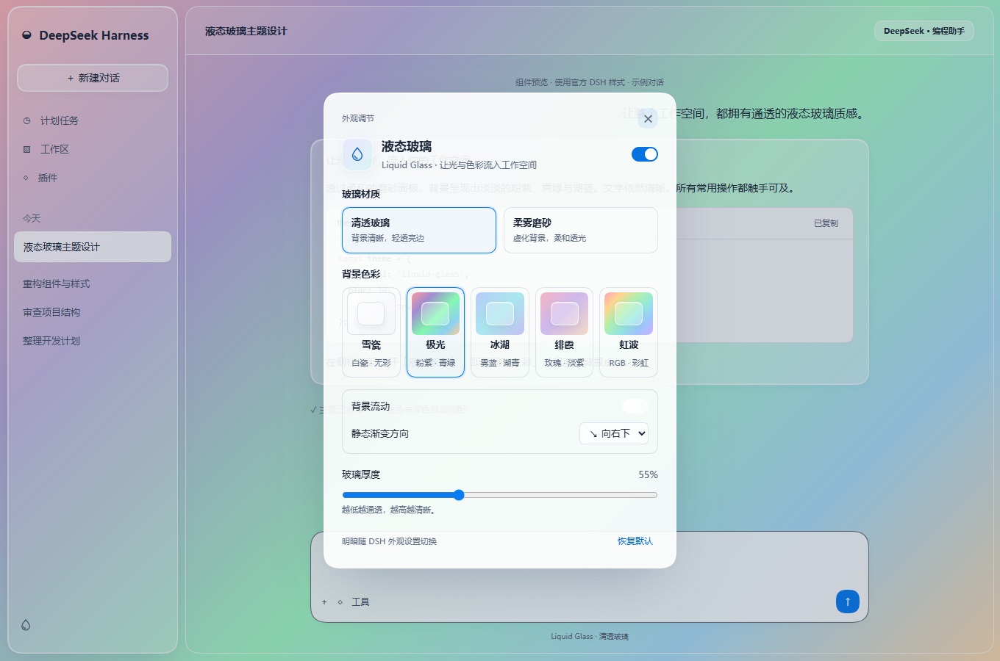

# DSH Liquid Glass

DeepSeek Harness 的全局玻璃主题，提供清透与磨砂面板、可调的流动背景，以及统一的左右侧栏圆角。当前版本 **1.5.2**，支持 **DSH 0.2.1-rc.5** 和 **0.2.2-rc.1**。使用官方 Cordis、Theme 和 UI 槽位接口。



上图为使用官方样式构造的离线示例，展示极光配色、色卡缩略图和静态渐变方向设置。

## 本版调整

- 主题和背景流动开关沿用 DSH 插件列表的原生开关组件。
- 左下角外观入口改为水滴图标。

## 安装与更新

1. 打开 DSH「插件 → 添加插件」。
2. 在「包名或地址」输入仓库地址：

   ```text
   https://github.com/Jeatricy/DSH_Liquid_Glass
   ```

3. 安装完成后点击「立即启用」。已安装旧版时，按插件管理器提示更新或先卸载旧版再安装新版本。
4. 左下角水滴按钮和「设置 → 通用」都能调整外观。

仓库包含已构建的客户端产物。也可以克隆仓库，按下文开发命令运行 `pnpm run pack`，再把生成的 `dist/dsh-liquid-glass-1.5.2.tgz` 的绝对路径填入安装框。

如果从命令行更新过 DSH 的 profile，插件页可能仍显示打开页面时的旧开关状态。点击插件页右上角的刷新即可重新读取；主题是否生效以页面外观和左下角「液态玻璃」面板为准。

## 外观选项

- **清透玻璃（默认）**：半透明底色与亮边，不做背景虚化。
- **柔雾磨砂**：保留虚化背景，可调 12–42px，默认 30px。
- **雪瓷**是纯白静态背景，深色模式下使用中性深色。
- **极光／冰湖／绯霞／虹波**都可单独开启「背景流动」。虹波默认开启，模拟 RGB 键盘的彩虹波浪。
- **流动方向与速度**由四款有色背景共用，支持八个方向。默认向右下、每 24 秒循环一次，五档速度覆盖每轮 8–48 秒。
- **静态渐变方向**在关闭流动时可单独设置，默认向右下。系统开启「减少动效」时也会使用所选的静态方向。
- **玻璃厚度**：35–90%，默认 55%。输入和设置表面有最低底色覆盖，保证文字阅读。
- **明暗、字体与字号**：沿用 DSH 原有设置。
- **主题开关**：关闭后撤销主题层，恢复 DSH 外观；也可在插件管理器禁用或卸载。

偏好存储在本机浏览器／桌面 WebView 的 localStorage，键为 `dsh-liquid-glass.preferences.v1`。不会写入会话，不上传网络。升级保留有效的配色、开关、材质、厚度和虚化设置；已删除的选项会被忽略。浏览器不支持滤镜、高对比和减少动效环境仍有自动回退。

## 窗口边界

当前 Windows 10 / DSH 0.2.1-rc.5 的窗口外轮廓和右上三键由原生桌面壳管理，正式插件接口不能将其去掉或替换为 macOS 三色按钮。本版按用户要求移除了额外的整页内框，避免多层套框。

嵌入网页、PDF 页面、跨源 iframe 与原生系统菜单不属于主题 CSS 的控制范围。代码高亮、终端、差异增删和业务状态色沿用 DSH 的语义颜色。更新 DSH 后需要重新检查兼容性。

## 开发与验证

需要 Node.js 22+ 和 pnpm。运行时无额外 npm 依赖，React 使用 DSH 共享实例。

```powershell
git clone https://github.com/Jeatricy/DSH_Liquid_Glass.git
cd DSH_Liquid_Glass
pnpm install --ignore-scripts
pnpm run build
pnpm test
pnpm run pack
```

- [主题样式](src/theme.css)：材质、原生 DSW token 和右侧停靠表面。
- [组件适配](src/adapters.js)：从官方样式元数据解析组件名，不写死构建哈希。
- [运行时](src/runtime.js)：可撤销 token 层、样式与 head 监听器。
- [设置界面](src/client.js)：原生设置槽位和侧栏快捷入口。
- [偏好保存](src/preferences.js)：校验、迁移、存储拒绝回退与跨窗口同步。
- [浏览器测试](test/browser.mjs)和[停靠布局测试](test/docking-fixture.mjs)：输入、主题开关、控件移除、视口尺寸、左右栏一致性，以及分栏、全屏、收起和浮动面板。

浏览器测试使用官方样式的离线样例，SDK 需要从本地安装提取。安装 DSH 桌面版后，可以用 [SDK 提取脚本](scripts/inspect-dsh.py) 准备参考资源。

```powershell
# Windows 标准安装路径会自动识别；非标准路径加 --archive 指定 app.asar。
python scripts/inspect-dsh.py .cache/dsh
pnpm run test:browser
```

也可设置 `DSH_SDK_REFERENCE_DIR` 指向自己的 SDK 参考目录。本机浏览器默认探测 Chrome／Edge，其他路径可通过 `DSH_TEST_BROWSER` 指定。个人会话截图、运行配置和本地测试报告不上传；验证范围见 [验证记录](docs/VALIDATION.md)。

[打包脚本](scripts/pack.mjs)生成 npm tgz 与 SHA-256；开发缓存、测试和依赖不会进入安装包。

[MIT 许可证](LICENSE)。
